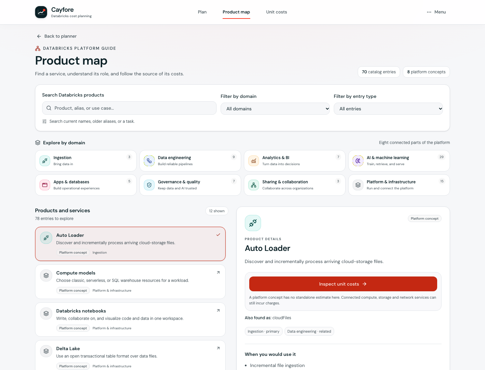
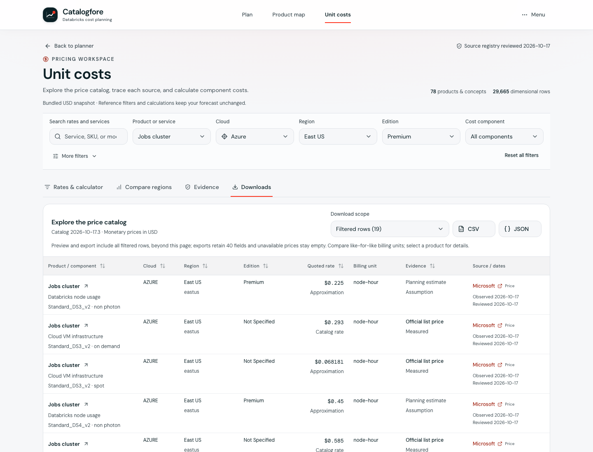
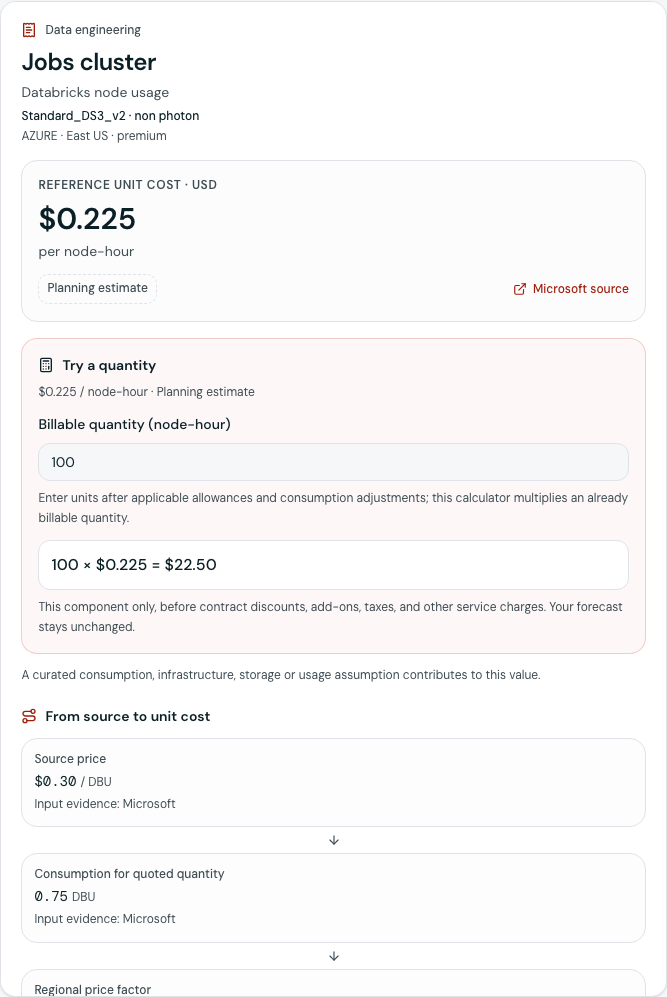
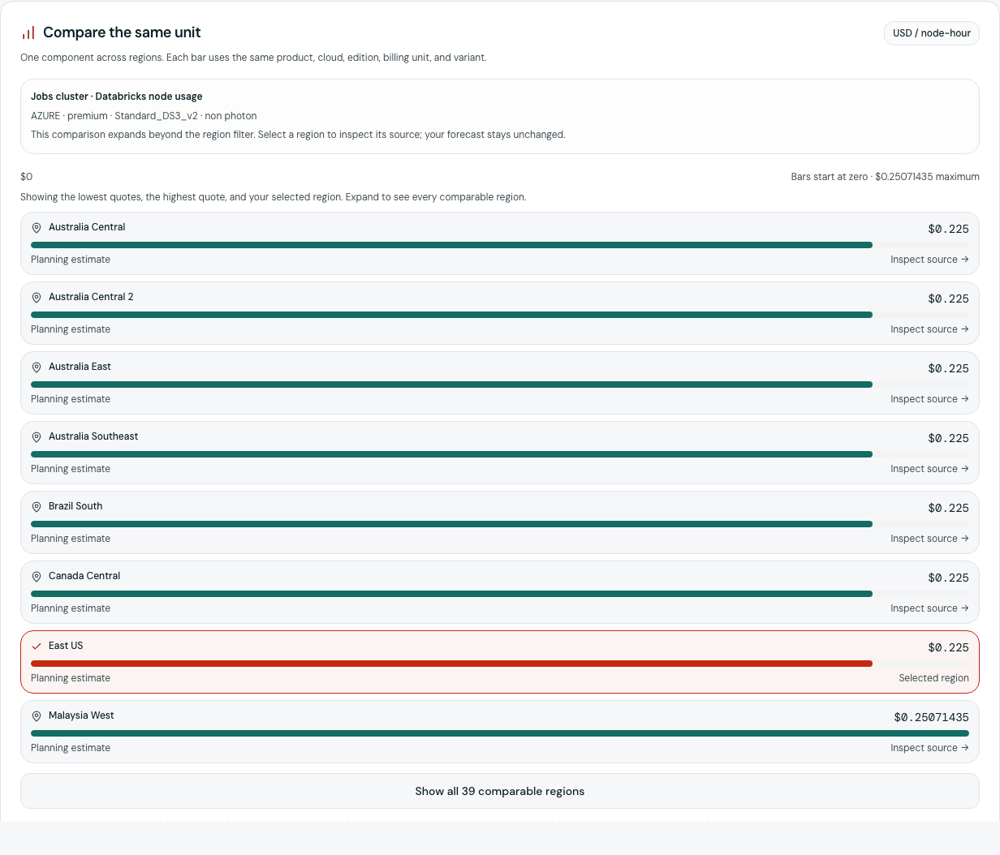
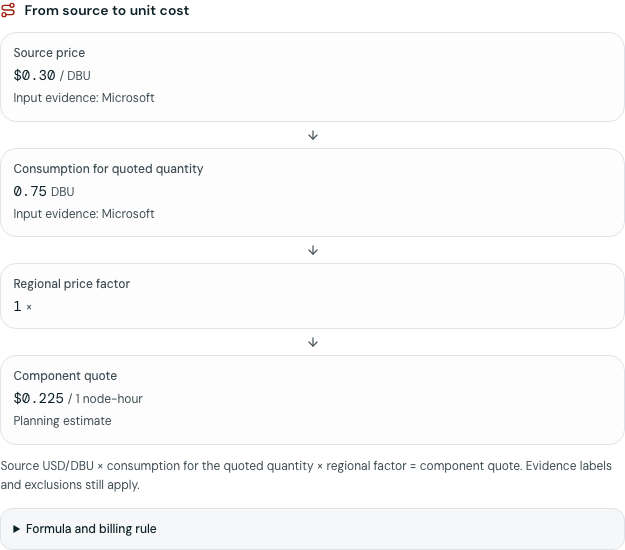
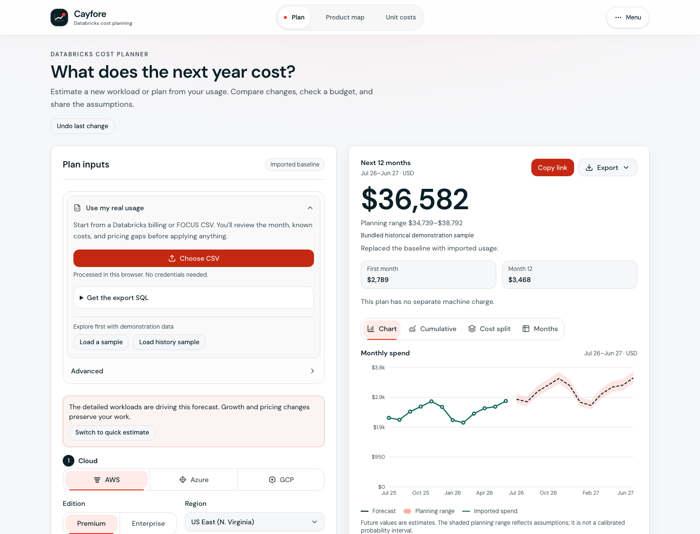
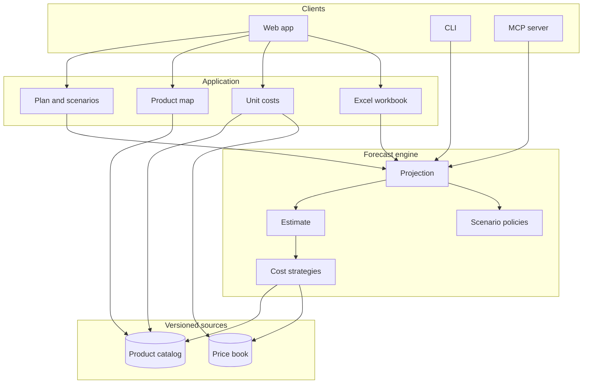

# Catalogfore

A browser-local Databricks budget and scenario planner, with a 12-month cost forecast.

[](LICENSE)
[](package.json)
[](https://santoshshinde2012.github.io/Catalogfore/)

Catalogfore is the interface. This repository is the forecast. It is an estimate, not a quote, and it is not affiliated with Databricks. The calculation stays in the browser. See [docs/PRIVACY.md](docs/PRIVACY.md).


## What it answers

Cloud and tier, a starting monthly amount or a team size, a mix of pipelines, dashboards, and models, and monthly growth. The page returns an annual total, planning range, charts and monthly values.

| Input          | Default                                          |
| -------------- | ------------------------------------------------ |
| Cloud and tier | AWS, Premium, reference region                   |
| Starting point | Medium, $12,000 a month                          |
| Mix            | 45% pipelines, 40% dashboards, 15% models        |
| Growth         | 3% a month, with an optional commitment discount |

That default estimates **about $170,258 per year, with a ±20% planning range**. First month **$11,997**. **29%** of the bill is cloud machines. The sources for the presets and the rates are in [docs/RESEARCH.md](docs/RESEARCH.md).

Usage import and Advanced are available at the top of Plan inputs. The forecast remains visible while editing on desktop, and a persistent shortcut shows the annual total on mobile. A usage CSV opens a review of its baseline month, prices, and gaps before replacing the estimate. Databricks billing and recognized FOCUS files are supported. Imported monetary costs stay observed costs; the app does not invent a separate VM bill. See [usage import](docs/USAGE-IMPORT.md).

The header keeps **Plan**, **Product map** and **Unit costs** directly accessible through plain text navigation with active underlines. One **Menu** groups forecast navigation, Advanced, explanatory help, file actions, appearance and GitHub. To continue a saved JSON forecast, choose **Menu → Open forecast**.

Set an annual budget, save named scenarios, and plan dated launches or retirements. Charts show observed spend, future estimates, budget variance, scenario comparisons, and monthly cost components. Advanced opens the per-workload editor. Growth and pricing controls preserve those workloads.

Open **Product map** to explore eight Databricks domains, all 70 catalog entries, and eight platform concepts. Search current names or older aliases, filter by domain, expand example architectures, and inspect roles, relationships, billing context, and official sources. Supported products can be added to the current forecast with Undo. [Product map research and maintenance](docs/PRODUCT-MAP.md) explains the taxonomy and pricing boundaries.



Open **Unit costs** for the source prices and consumption rules behind each product. **Rates & calculator** opens the working quote immediately; **Compare regions**, **Evidence** and **Downloads** provide focused supporting views. **More filters** reveals the additional evidence and coverage controls. Official price links, publisher names, snapshot dates, and evidence labels appear beside prices. Direct official prices, derived rates, planning estimates, and unresolved conflicts can be filtered separately. Filter by product, cloud, region, edition, component, or evidence status; inspect machines, models, token directions, and other variants; then enter a quantity to calculate a component subtotal. Compare the same configured unit across regions, inspect the source-to-quote calculation path, and view evidence coverage without combining unlike prices. The calculator, visual scales, CSV/JSON and Excel share the engine quote policy. Product map and forecast rows link to the relevant reference costs. [Unit-cost documentation](docs/UNIT-COSTS.md) explains sources, missing prices, assumptions, and pricing conflicts.

The calculator previews the change to your first-month and 12-month forecast before you apply a supported monthly quantity. **Add to forecast** and **Update forecast** preserve existing workloads and planning settings; **View forecast** and **Undo change** remain available after applying. Imported dollar costs and products driven by schedules or other inputs explain why their quantities must be edited elsewhere.

**Downloads** previews the catalog as a sortable, paginated table with billing units, evidence and source dates. Inspect an exact row or export all filtered rows or the complete catalog as ordinary CSV or JSON; pagination never limits the file. Run `npm run export:unit-costs` to create both locally. Complete, lossless copies are versioned as [CSV](data/generated/unit-costs.csv.gz) and [JSON](data/generated/unit-costs.json.gz) gzip files. The bundled USD snapshot is catalog **2026-10-19.1**: 70 pricing products, eight platform concepts, and 29,665 dimensional rows. An unknown rate stays empty rather than free.











Forecast CSV, JSON, PDF, and shared plans use the same forecast result. Unpriced charges are identified as unresolved; the total is a known subtotal when costs are missing. The range represents planning assumptions, not a calibrated probability interval.


## Run

```bash
npm install
npm run dev
```

Open http://localhost:5173/Catalogfore/

Use Node 22.13+ within Node 22, or Node 24+. Run `nvm use` to select Node 22 from `.nvmrc`.

```bash
npm test          # engine unit tests and the price-file parser
npm run lint
npm run typecheck
npm run check:sources # replay official price captures and validate accepted rates
npm run check:unit-costs # committed CSV/JSON still match their source inputs
npm run build
npm run test:mcp  # stdio MCP smoke test
npm run test:e2e  # Playwright, desktop and mobile, including axe
```

The core JavaScript is about 290 KB gzipped, including the separately cached price catalog. Charts, the product map and its metadata, PDF, and Excel export load in separate chunks. CSS is about 11 KB gzipped, before the font files.

## Architecture

The web app, the command line, and the MCP server call one forecast engine. Pricing stays in versioned files. A new screen does not keep its own rate table.



Clients choose a plan, a product, or a unit price. The engine projects that request through an estimate and a cost strategy. Strategies read the product catalog and the price book. Excel export is a separate package and loads only when someone exports. The layering, and how to add a product without editing the estimate, is in [docs/ARCHITECTURE.md](docs/ARCHITECTURE.md).

## Repository

| Path                         | Role                                                                    |
| ---------------------------- | ----------------------------------------------------------------------- |
| `packages/engine`            | Pricing, the four-input forecast, scenarios, and usage import           |
| `packages/sheet`             | Excel workbook export. Loaded only when someone exports                 |
| `data/`                      | Versioned rates, instance ratings, and virtual-machine prices           |
| `apps/web`                   | The forecast page                                                       |
| `mcp/`                       | The stdio server over the same engine                                   |
| `scripts/weekly-catalog.ts`  | Monday catalog and price check. Dry-run by default                      |
| `scripts/refresh-prices.mjs` | VM and Azure DBU meter refresh. Instance DBU counts stay cited.         |
| `docs/DATA-PIPELINE.md`      | Where those prices come from, and how the weekly job runs               |
| `docs/CATALOG.md`            | Product catalog schema, citations, and the watch                        |
| `docs/PRODUCTS.md`           | Product inventory and which rows have a list rate                       |
| `docs/PRODUCT-MAP.md`        | Learning domains, service relationships, aliases, and source evidence   |
| `docs/UNIT-COSTS.md`         | Source unit prices, dimensions, formulas, CSV/JSON, and evidence limits |
| `docs/COVERAGE.md`           | Which products and Azure cells have a cited rate                        |
| `docs/RESEARCH.md`           | Source for every rate                                                   |
| `docs/NAMING.md`             | Why the product is called Catalogfore                                   |
| `docs/ARCHITECTURE.md`       | How the pricing code is split                                           |
| `docs/USABILITY.md`          | Walkthroughs for evaluating, budgeting, and a usage file                |
| `docs/USAGE-IMPORT.md`       | Typed import, period selection, currencies, corrections, and cost basis |
| `docs/PLAN.md`               | What the page covers, and what the engine still prices                  |
| `docs/ROADMAP.md`            | Gaps versus other calculators, and what is not in this pass             |
| `docs/PRIVACY.md`            | What stays in the browser                                               |
| `docs/FAQ.md`                | Short answers for the public FAQ page                                   |
| `docs/MCP.md`                | Tool arguments and a client config                                      |
| `docs/MAINTENANCE.md`        | How dependency updates are grouped                                      |
| `SECURITY.md`                | How to report a vulnerability                                           |
| `CHANGELOG.md`               | What is unreleased. GitHub Releases are cut by the owner                |
| `NOTICE`                     | License notice for the code and the price sources                       |

## Publish

Pushes to `main` publish the site from `.github/workflows/pages.yml`. The address is https://santoshshinde2012.github.io/Catalogfore/

Vite’s base path is `/Catalogfore/`. Unknown addresses serve `404.html`. The repository social-preview image is `.github/social-preview.png` (1280×640). Upload that file in the repository settings if GitHub has not picked it up. Topics and the description belong on the repository, not in the page.

One weekly workflow, Mondays at 06:00 UTC, refreshes AWS and Azure list prices and checks allowed Databricks metadata for new or renamed products. It opens a single review pull request and does not merge. GCP virtual-machine rates stay seeded unless `GCP_BILLING_API_KEY` is set. Do not commit that key. The job captures and validates official Databricks price-card and calculator JSON before updating the shared resolver. Saved source responses make the accepted rates reproducible. The forecast page prints the catalog date; individual source observation dates are separate. Details are in [docs/DATA-PIPELINE.md](docs/DATA-PIPELINE.md).

## MCP

`mcp/` speaks stdio and does not log into a workspace. A browser page cannot call the Databricks SQL API. Tools: `list_skus`, `list_products`, `estimate_workload`, `estimate_product`, `forecast`, `compare_scenarios`, `forecast_usage`, and `export_xlsx`. `npm run catalogfore -- estimate --xlsx forecast.xlsx` writes the same Excel workbook the page downloads.

```bash
npm run build
node mcp/dist/index.js
```

Arguments, a client config, and the fixture numbers are in [docs/MCP.md](docs/MCP.md).

## License

[MIT](LICENSE). Read [CONTRIBUTING.md](CONTRIBUTING.md) before changing a rate.
