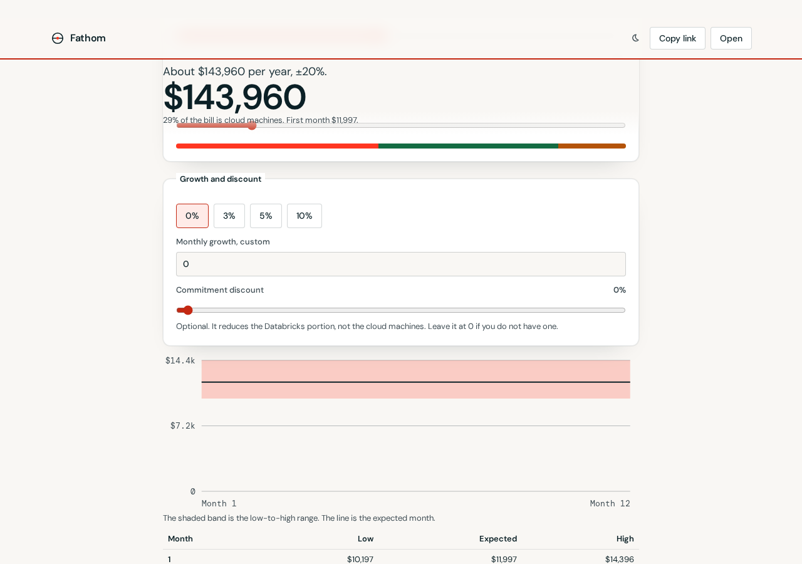

# Databricks Cost Forecaster

An open-source 12-month forecast for Databricks spend. The page asks for four things: cloud and tier, a starting monthly amount or a Small / Medium / Large team, a mix of pipelines, dashboards, and models, and a monthly growth rate. It answers with one sentence, a low-to-high chart, and a month table.

It is deliberately not a quote, and it is not affiliated with Databricks. List rates are versioned and sourced. The interface is Fathom: DM Sans, an oat page, white cards, navy text, and a lava accent. A navy dark theme is optional. How the pricing code is split is in [docs/ARCHITECTURE.md](docs/ARCHITECTURE.md). Who the page is for is in [docs/USABILITY.md](docs/USABILITY.md).


The simple forecast builds three workloads and hands them to the existing pricing engine. It does not keep a second rate table. Advanced opens the per-workload builder. A `system.billing.usage` CSV replaces the monthly amount and the mix.

## What you can do

- Pick AWS, Azure, or GCP, and Premium or Enterprise. Region defaults to the reference region and can be changed.
- Start from Small ($2,000), Medium ($12,000), or Large ($25,000), or type a monthly amount. The preset shows the mix it assumes.
- Move the mix. Pipelines carry a cloud machine charge. Dashboards are serverless. Models are token usage. The engine prices each, so the machine share of the bill changes with the mix.
- Set monthly growth to 0, 3, 5, or 10 percent, or type another rate. An optional commitment discount applies to the Databricks portion only.
- Read a 12-month band, the year total, and “About $X per year, ±Y%.” Export CSV, JSON, or PDF, or copy a link.
- Upload a usage CSV when you have one. The range gets tighter. Growth, cloud, and the discount stay.
- Open Advanced for jobs, SQL, pipelines, serving, and the rest of the workload editor.
- If you already have an account admin, the footer links to Usage Dashboard 2.0, budgets, and `ai_forecast`. Those need billing history. This page does not.




## Estimates only

Catalog **2026-10-16.1**, verified **2026-10-16**. Azure Premium DBU meters in East US were re-read from the Retail Prices API and matched the catalog. AWS and GCP classic dollar rates still come from secondary guides, because those public price pages render the numbers in the browser. Region factors for AWS and Azure are first-party Lakehouse Real-Time ratios. Model training at $0.65/DBU in US East, the SQL t-shirt ladder, Photon at 2.9×, and the serving and AI Search DBU counts are from Microsoft Learn or Databricks docs. The research note cites each one: [docs/RESEARCH.md](docs/RESEARCH.md).

A 30% Lakehouse Real-Time emission promo runs through 2027-01-31. This app does not apply it. That promo is not a discount on jobs, SQL, or serving.

VM prices outside the reference region reuse the reference hourly rate until the weekly refresh replaces them. Azure Retail Prices and the public AWS EC2 offer file can update `data/cloud-vm-prices.json`. Azure Databricks DBU meters are in that same Retail Prices API. databricks.com still has no public price API.

## Run it

```bash
npm install
npm run dev
```

Open http://localhost:5173/databricks-cost-forecaster/

```bash
npm test          # engine unit tests and the price-file parser
npm run lint
npm run typecheck
npm run build
npm run test:mcp  # stdio MCP smoke test
npm run test:e2e  # Playwright, desktop and mobile, including axe
```

Node 20 or newer. The production bundle is about 99 KB of JavaScript and 6 KB of CSS, gzipped, before the DM Sans and DM Mono files. PDF export loads on demand.

## MCP

`mcp/` is a stdio server over the same engine: `list_skus`, `estimate_workload`, `forecast`, `compare_scenarios`. No workspace login.

```bash
npm run build
node mcp/dist/index.js
```

Tool arguments, a client config, and the fixture numbers are in [docs/MCP.md](docs/MCP.md).

## GitHub Pages

The site is published from `.github/workflows/pages.yml` on pushes to `main`. Vite’s base path is `/databricks-cost-forecaster/`.

After the first merge, set **Settings → Pages → Build and deployment → Source** to **GitHub Actions**. Nothing else is required for the first deploy. The address is https://santoshshinde2012.github.io/databricks-cost-forecaster/

A weekly workflow opens a pull request when AWS or Azure VM prices for the curated instances change. GCP VM rates stay seeded unless `GCP_BILLING_API_KEY` is set. Do not commit that key.

## Layout

| Path                         | Role                                                                    |
| ---------------------------- | ----------------------------------------------------------------------- |
| `packages/engine`            | Pricing, the four-input forecast, scenarios, usage import. Unit tested. |
| `data/`                      | Versioned SKU rates, instance DBU ratings, VM prices.                   |
| `apps/web`                   | The calculator.                                                         |
| `mcp/`                       | The stdio server.                                                       |
| `scripts/refresh-prices.mjs` | Unauthenticated VM price refresh.                                       |
| `docs/RESEARCH.md`           | Sources for every rate.                                                 |
| `docs/ARCHITECTURE.md`       | Modules, injected catalog and strategies, and how SOLID is applied.     |
| `docs/PLAN.md`               | How the pieces fit together.                                            |
| `docs/USABILITY.md`          | Persona walkthroughs and how this compares with other calculators.      |

## License

[MIT](LICENSE). See [CONTRIBUTING.md](CONTRIBUTING.md) before changing a rate.
