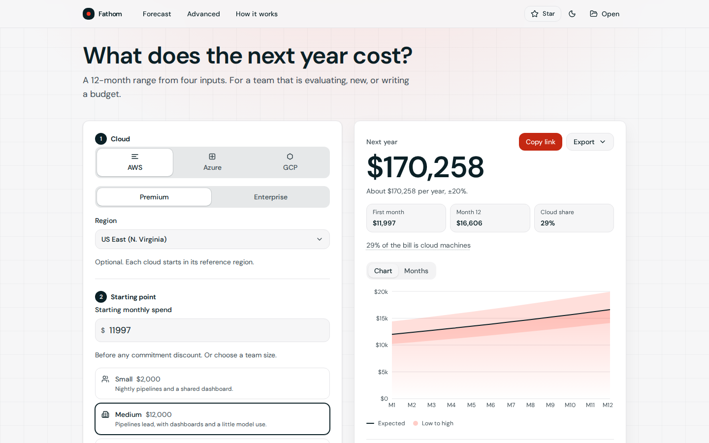
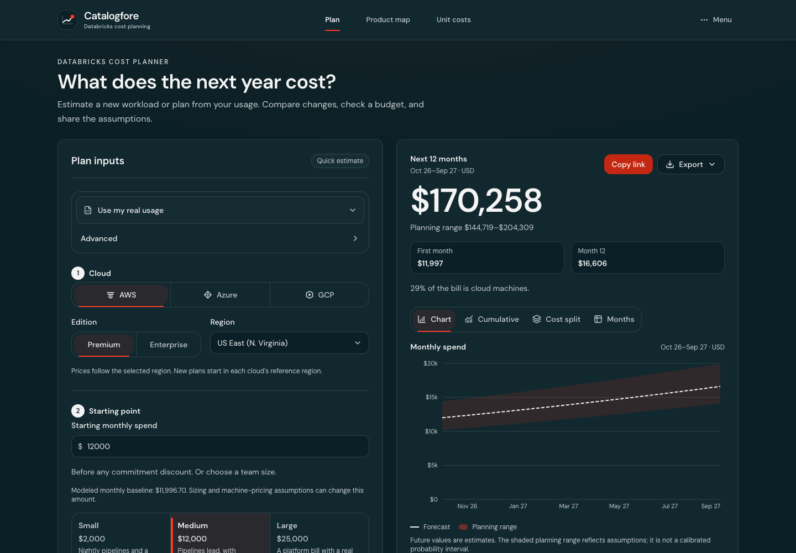
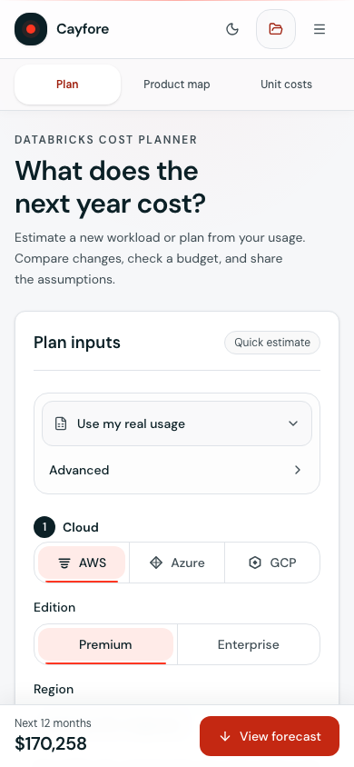
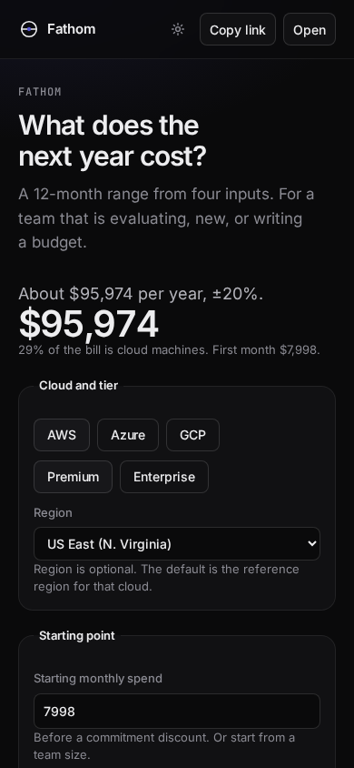

# Cayfore

A 12-month forecast of Databricks spend. Four inputs, one range.

[](LICENSE)
[](package.json)
[](https://santoshshinde2012.github.io/databricks-cost-forecaster/)

Cayfore is the interface. This repository is the forecast. It is an estimate, not a quote, and it is not affiliated with Databricks. The calculation stays in the browser. See [docs/PRIVACY.md](docs/PRIVACY.md).



## What it answers

Cloud and tier, a starting monthly amount or a team size, a mix of pipelines, dashboards, and models, and monthly growth. The page returns a low-to-high year, a sentence, a chart, and a month table.

| Input          | Default                                          |
| -------------- | ------------------------------------------------ |
| Cloud and tier | AWS, Premium, reference region                   |
| Starting point | Medium, $12,000 a month                          |
| Mix            | 45% pipelines, 40% dashboards, 15% models        |
| Growth         | 3% a month, with an optional commitment discount |

On that default the page reads **about $170,258 per year, ±20%**. First month **$11,997**. **29%** of the bill is cloud machines. The sources for the presets and the rates are in [docs/RESEARCH.md](docs/RESEARCH.md).

A usage CSV replaces the monthly amount and the mix. Advanced opens the per-workload editor. Savings stay under the result, each with an annual amount.







## Run

```bash
npm install
npm run dev
```

Open http://localhost:5173/databricks-cost-forecaster/

Node 20 or newer.

```bash
npm test          # engine unit tests and the price-file parser
npm run lint
npm run typecheck
npm run build
npm run test:mcp  # stdio MCP smoke test
npm run test:e2e  # Playwright, desktop and mobile, including axe
```

The page JavaScript is about 346 KB gzipped, including the chart and the price catalog. CSS is about 8 KB gzipped, before the font files. PDF export loads on demand.

## Repository

| Path                         | Role                                                            |
| ---------------------------- | --------------------------------------------------------------- |
| `packages/engine`            | Pricing, the four-input forecast, scenarios, and usage import   |
| `data/`                      | Versioned rates, instance ratings, and virtual-machine prices   |
| `apps/web`                   | The forecast page                                               |
| `mcp/`                       | The stdio server over the same engine                           |
| `scripts/refresh-prices.mjs` | VM and Azure DBU meter refresh. Instance DBU counts stay cited. |
| `docs/DATA-PIPELINE.md`      | Where those prices come from, and how the weekly job runs       |
| `docs/RESEARCH.md`           | Source for every rate                                           |
| `docs/NAMING.md`             | Why the product is called Cayfore                               |
| `docs/ARCHITECTURE.md`       | How the pricing code is split                                   |
| `docs/USABILITY.md`          | Walkthroughs for evaluating, budgeting, and a usage file        |
| `docs/PLAN.md`               | What the page covers, and what the engine still prices          |
| `docs/ROADMAP.md`            | Gaps versus other calculators, and what is not in this pass     |
| `docs/PRIVACY.md`            | What stays in the browser                                       |
| `docs/MCP.md`                | Tool arguments and a client config                              |
| `CHANGELOG.md`               | What is unreleased. GitHub Releases are cut by the owner        |
| `NOTICE`                     | License notice for the code and the price sources               |

## Publish

Pushes to `main` publish the site from `.github/workflows/pages.yml`. The address is https://santoshshinde2012.github.io/databricks-cost-forecaster/

Vite’s base path is `/databricks-cost-forecaster/`. Unknown addresses serve `404.html`.

A weekly workflow opens a pull request when AWS or Azure list prices change: EC2 on-demand for every catalog region, and Azure VM and Databricks DBU meters. Instance DBU counts stay in the cited table. GCP virtual-machine rates stay seeded unless `GCP_BILLING_API_KEY` is set. Do not commit that key. The curated $/DBU table is not rewritten. Details are in [docs/DATA-PIPELINE.md](docs/DATA-PIPELINE.md).

## MCP

`mcp/` speaks stdio and does not log into a workspace. A browser page cannot call the Databricks SQL API. Tools: `list_skus`, `estimate_workload`, `forecast`, `compare_scenarios`, `forecast_usage`. `npm run cayfore` runs the same forecast from the shell.

```bash
npm run build
node mcp/dist/index.js
```

Arguments, a client config, and the fixture numbers are in [docs/MCP.md](docs/MCP.md).

## License

[MIT](LICENSE). Read [CONTRIBUTING.md](CONTRIBUTING.md) before changing a rate.
