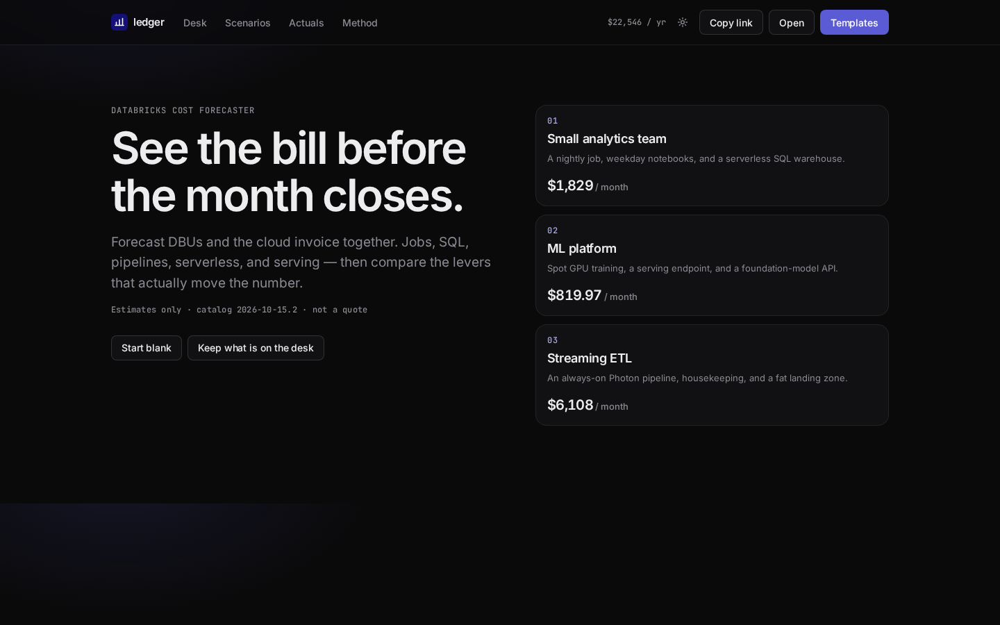
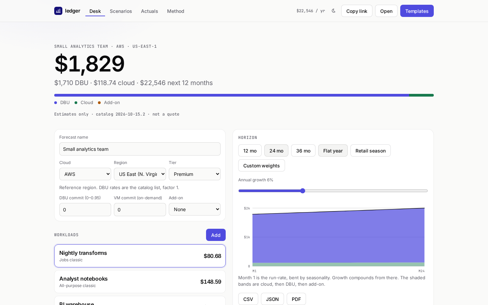
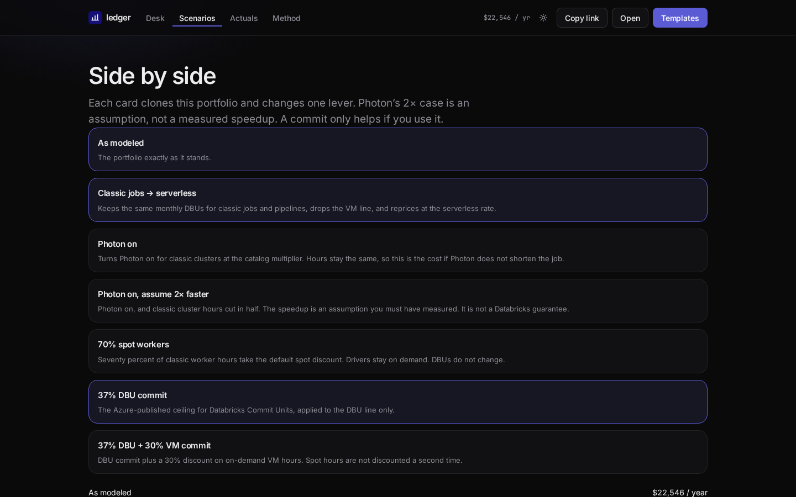
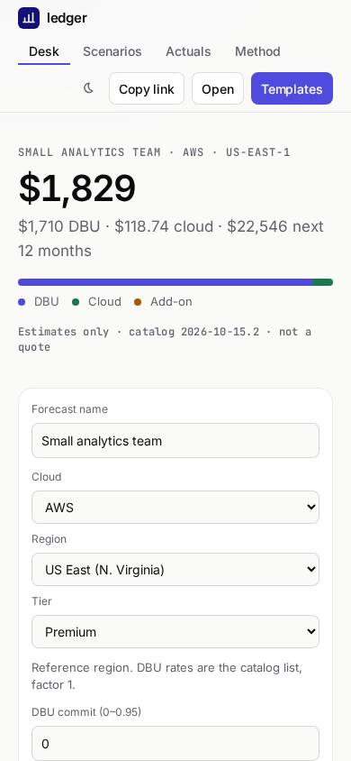

# Databricks Cost Forecaster

An open-source forecast for Databricks spend. It prices a portfolio of jobs, notebooks, SQL warehouses, Lakeflow pipelines, serverless compute, model serving, and the cloud bill next to the DBU bill, then projects 12 to 36 months with growth, seasonality, and commitment scenarios.

It is deliberately not a quote. List rates are versioned, sourced, and labeled when a figure is a proxy. The interface uses the same type, color, and spacing system as [holdmap](https://santoshshinde2012.github.io/holdmap/): Inter, JetBrains Mono, near-black and off-white surfaces, and one indigo accent.





The running total is the point. Templates, edits, scenarios, and a usage-file scale all move the same number.

## What you can do

- Build a portfolio: classic and serverless jobs, all-purpose clusters, Lakeflow pipelines, SQL warehouses, model serving, foundation-model APIs, AI Search, Apps, Lakebase, storage, and egress.
- Pick cloud, region, and tier. AWS covers every region on the Lakehouse Real-Time price page. Azure covers all 39 regions on the Microsoft Learn table that took effect on 2026-10-10. Those ratios are applied as a proxy to other SKUs and the page says so. GCP regions outside the reference region stay labeled as proxies.
- Set hours per day, days per week, and autoscaling min, max, and utilization. Photon, spot, and commits each touch only the line they are supposed to.
- See this month split into DBU, cloud infrastructure, and add-ons, plus a 12, 24, or 36 month chart.
- Compare classic vs serverless, Photon, an explicit Photon speedup assumption, spot, and commitment discounts side by side.
- Share the forecast in the URL, save and open JSON, and export CSV or PDF.
- Import a `system.billing.usage` CSV and scale the forecast to last month’s DBUs. The file is not a price list, and it has no VM bill, so cloud dollars scale with DBUs and the page says that.
- Switch light and dark. The layout fits a phone.





## Estimates only

Catalog **2026-10-15.2**, verified **2026-10-15**. Dollar rates for many classic SKUs come from secondary guides because the public Databricks price pages render the numbers in the browser. Region factors for AWS and Azure are first-party Lakehouse Real-Time ratios. Model training at $0.65/DBU in US East, the SQL t-shirt ladder, Photon at 2.9×, and the serving and AI Search DBU counts are from Microsoft Learn or Databricks docs. The research note cites each one: [docs/RESEARCH.md](docs/RESEARCH.md).

A 30% Lakehouse Real-Time emission promo runs through 2027-01-31. This app does not apply it. That promo is not a discount on jobs, SQL, or serving.

VM prices outside the reference region reuse the reference hourly rate until the weekly refresh replaces them. Azure Retail Prices and the public AWS EC2 offer file can update `data/cloud-vm-prices.json`. There is no public Databricks price API.

## Run it

```bash
npm install
npm run dev
```

Open http://localhost:5173/databricks-cost-forecaster/

```bash
npm test          # engine unit tests and the price-file parser
npm run lint
npm run typecheck
npm run build
npm run test:mcp  # stdio MCP smoke test
npm run test:e2e  # Playwright, desktop and mobile, including axe
```

Node 20 or newer. The production bundle is about 94 KB of JavaScript and 5 KB of CSS, gzipped, before fonts. PDF export loads on demand.

## MCP

`mcp/` is a stdio server over the same engine: `list_skus`, `estimate_workload`, `forecast`, `compare_scenarios`. No workspace login.

```bash
npm run build
node mcp/dist/index.js
```

Tool arguments, a client config, and the fixture numbers are in [docs/MCP.md](docs/MCP.md).

## GitHub Pages

The site is published from `.github/workflows/pages.yml` on pushes to `main`. Vite’s base path is `/databricks-cost-forecaster/`.

After the first merge, set **Settings → Pages → Build and deployment → Source** to **GitHub Actions**. Nothing else is required for the first deploy. The address is https://santoshshinde2012.github.io/databricks-cost-forecaster/

A weekly workflow opens a pull request when AWS or Azure VM prices for the curated instances change. GCP VM rates stay seeded unless `GCP_BILLING_API_KEY` is set. Do not commit that key.

## Layout

| Path | Role |
| --- | --- |
| `packages/engine` | Pricing, forecast, scenarios, usage import, URL codec. Unit tested. |
| `data/` | Versioned SKU rates, instance DBU ratings, VM prices. |
| `apps/web` | The calculator. |
| `mcp/` | The stdio server. |
| `scripts/refresh-prices.mjs` | Unauthenticated VM price refresh. |
| `docs/RESEARCH.md` | Sources and the rate ledger. |
| `docs/PLAN.md` | How the pieces fit together. |

## License

[MIT](LICENSE). See [CONTRIBUTING.md](CONTRIBUTING.md) before changing a rate.
