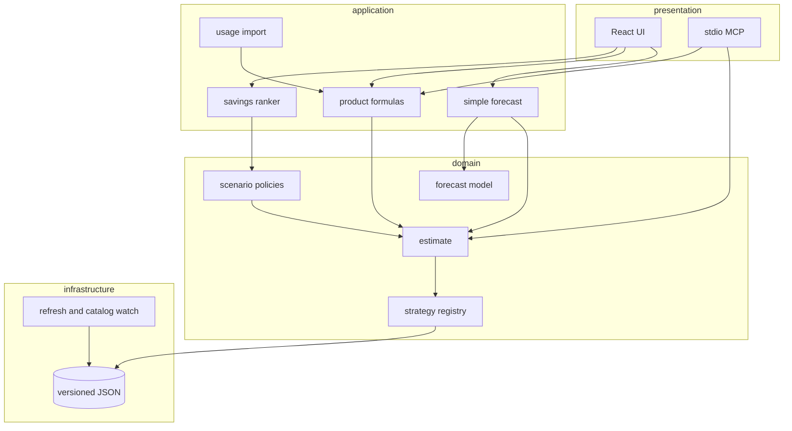

# Architecture

Cayfore prices a portfolio by composing small units. The website and the MCP server both call the same engine. Neither one owns a rate table or a pricing formula.

## Units

| Unit                            | Responsibility                                                                                                                                 | Depends on                                             |
| ------------------------------- | ---------------------------------------------------------------------------------------------------------------------------------------------- | ------------------------------------------------------ |
| `@cayfore/catalog`              | Product inventory: SKU, billing unit, confidence, citation, and the inputs a new row needs. Zod validates it.                                  | `data/product-catalog.json`                            |
| `products.ts`                   | Turns a catalog id into one workload per underlying SKU, applies a named formula, and splits a 12-month forecast by product.                   | `@cayfore/catalog`, `createWorkload`                   |
| `catalog/pricing-catalog.ts`    | `PricingCatalog`. The bundled object reads the versioned JSON. A test can pass a different book.                                               | JSON files, via `catalog.ts`                           |
| `costing/strategies/*`          | One `CostStrategy` per workload kind. Each file prices that kind only.                                                                         | `PricingCatalog`, pure helpers in `costing/support.ts` |
| `costing/estimate-portfolio.ts` | Walks the portfolio, finds a strategy, scales lines, adds the add-on. It does not know how a SKU is priced.                                    | `CostStrategy[]`, `PricingCatalog`                     |
| `forecast/model.ts`             | Turns one month’s estimate into 12–36 points. Growth and seasonality only.                                                                     | An `Estimate`                                          |
| `forecast/series.ts`            | Fits an imported usage history to twelve months, with an approximate interval.                                                                 | Usage points                                           |
| `policies/scenario-policies.ts` | Named mutations: serverless, Photon, spot, commits. Each policy is data plus `apply`.                                                          | `PricingCatalog` when a policy needs a rate            |
| `recommend.ts`                  | Ranks policies and the autostop / right-size adjustments by annual dollars.                                                                    | `estimate`, `forecast`, `applyScenario`                |
| `simple/`                       | Turns four inputs into a portfolio. Mix, presets, monthly growth, and a usage file set workload sizes. It does not price a SKU itself.         | `estimate`, `forecast`, `uncertaintyFactors`           |
| `apps/web/src/hooks`            | Session and derived view state: URL, theme, bands, recommendations.                                                                            | Engine functions                                       |
| `apps/web/src/components`       | Presentational pieces. They receive data and callbacks. The Advanced ledger reads the product catalog for the picker and the per-product year. | Props, product catalog                                 |

## How SOLID shows up

**Single responsibility.** A cluster file does not forecast. The forecast file does not know what a DBU is. A React card does not encode the URL hash. `useSimpleForecast` does. The simple module only chooses workload sizes. `estimate()` still prices them.

**Open/closed.** A new workload kind is a new strategy file added to `defaultCostStrategies`, plus a presentational editor registered in `components/editor/registry.tsx`. `estimate()` does not grow a switch. A new product that uses a kind already in the registry is a row in `data/product-catalog.json`. The Advanced picker and the schema-driven fields read that row, so the new product does not need a new React component. A new what-if is a new `ScenarioPolicy` in the policy list. `applyScenario` looks the policy up. The four-input page is another caller of those interfaces. Changing the mix does not add a formula to the strategies.

**Liskov.** Every `CostStrategy` accepts a workload and a `CostContext` and returns a `RawLine`. Callers do not special-case the kind after the quote. Every `ScenarioPolicy` returns a new portfolio and leaves the input alone.

**Interface segregation.** Strategies see `PricingCatalog`, not the JSON documents and not the React tree. The forecast sees an `Estimate`, not a portfolio. Presentational components see the fields they render.

**Dependency inversion.** `estimate(portfolio, dependencies)` takes a catalog and a strategy list. The default is the bundled book. Tests pass a fake catalog and, in one case, a strategy that did not exist when the estimator was written. Scenario policies receive the catalog instead of importing a global rate table for the spot discount and the Photon multiplier.

## What stays pure

Pricing, forecasting, policies, recommendations, and portfolio normalization are functions of their arguments. They do not read the clock, the network, or `localStorage`. The UI hook is the place that touches the URL and the theme.

## Errors

A missing strategy throws `MissingCostStrategyError`. A scenario id that is not in the supplied policy list throws `UnknownScenarioError`. A JSON file that is not a forecast is rejected in the session hook with a visible alert. PDF export reports a failure on the page instead of failing silently.

## Review on 2026-10-16

| Finding                                                                       | Fix                                                                                                                                                                   |
| ----------------------------------------------------------------------------- | --------------------------------------------------------------------------------------------------------------------------------------------------------------------- |
| Several modules mixed lookup, formulas, and forecasting, or passed 200 lines. | Split along the existing seams: formulas, product forecast, CSV parsing, portfolio normalization, forecast fits, plan edits, plan sections, MCP tools, price refresh. |
| Exporters and usage importers were direct calls.                              | `forecastExporters` and `usageImporters` are registries. Formulas and cost strategies already were.                                                                   |
| Strategy tests named kinds one by one.                                        | One contract test runs every registered strategy and every catalog formula.                                                                                           |
| The engine could have imported React or `fetch` without a CI failure.         | `dependency-cruiser` plus ESLint restricted globals. Costing cannot import the product or simple modules.                                                             |
| Confidence was a word, not a score, and proxy cells were not counted.         | `confidenceScore` on each product. `data/rate-confidence.json` scores every cloud, region, tier, and SKU cell.                                                        |
| Actions used floating tags. Coverage had no threshold.                        | Action SHAs are pinned. Engine lines, functions, and statements must stay at or above 90%.                                                                            |

## Checks

ESLint (including `@typescript-eslint/no-explicit-any` and a 200-line module cap), Prettier, and dependency-cruiser run from `npm run lint`. Vitest covers the bundled estimate, the strategy contract, and the formula registry. Engine coverage is enforced in that run.
