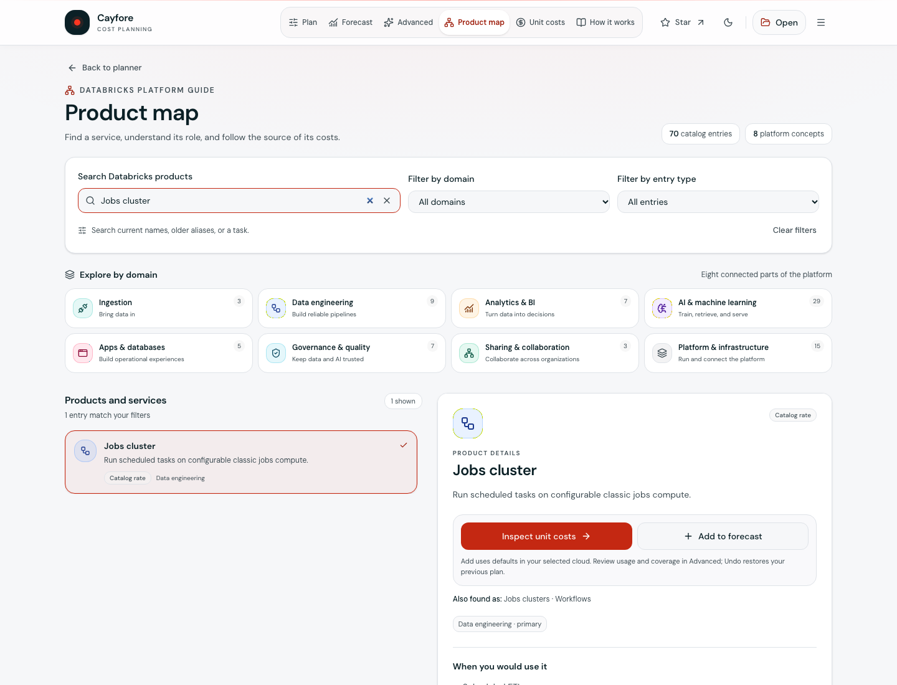

# Databricks product map

Reviewed on **2026-10-17**. The Product map helps users understand what a service does, where it fits, which services it can work with, and what to consider before estimating its cost.

Open **Product map** from the persistent header navigation. Search names, aliases and use cases, then use the compact domain navigation or filters to narrow the directory. Example architectures expand under **See how the pieces work together** below the workspace. The selected service explains its role, costs, relationships, and sources. Supported catalog components can be appended to the active forecast with Undo. Browser history and reload retain the current plan.

The eight domains are Cayfore's editorial navigation, not an official or exclusive Databricks classification. A product has one primary domain and can have related domains. For example, training belongs under AI & machine learning even though the existing pricing inventory groups its meter under Data Engineering. Lakehouse Real-Time belongs under analytics because it is a specialized SQL warehouse, rather than a Spark streaming mode. See [data engineering](https://docs.databricks.com/aws/en/data-engineering/), [model training](https://docs.databricks.com/aws/en/machine-learning/train-model/), and [SQL warehouse types](https://docs.databricks.com/aws/en/compute/sql-warehouse/warehouse-types).

| Domain                    | What users learn                                                                |
| ------------------------- | ------------------------------------------------------------------------------- |
| Ingestion                 | Bring database changes, application data, files, and events into the lakehouse. |
| Data engineering          | Transform data and orchestrate batch and streaming workflows.                   |
| Analytics & BI            | Query data and deliver dashboards or conversational analysis.                   |
| AI & machine learning     | Train, retrieve, serve, and evaluate models and agents.                         |
| Apps & databases          | Build operational applications and transactional Postgres services.             |
| Governance & quality      | Manage access, lineage, quality, maintenance, and AI governance.                |
| Sharing & collaboration   | Exchange data products and collaborate with other organizations.                |
| Platform & infrastructure | Understand compute, notebooks, storage, and networking.                         |

## Products, services, and pricing entries

[data/product-map.json](../data/product-map.json) maps all **70** current pricing entries exactly once and adds **eight** learning foundations: Unity Catalog, Delta Lake, MLflow, Lakeflow Jobs orchestration, notebooks, Photon, Auto Loader, and compute models. These foundations explain the platform without adding duplicate forecast lines.

The map joins pricing entries by stable `productId`. The [pricing catalog](../data/product-catalog.json) remains the source for billing units, price coverage, confidence, and estimate templates. Learning names and descriptions can override display text; the underlying catalog names, IDs, pricing formulas, and rates remain unchanged. An inventory entry can describe a billing component, legacy meter, or assumption rather than a separate product available for purchase.

[Unity Catalog](https://docs.databricks.com/aws/en/data-governance/unity-catalog/) governs assets; [Delta Lake](https://docs.databricks.com/aws/en/delta) is a transactional table format. [MLflow](https://docs.databricks.com/aws/en/mlflow/) manages experiments, models, tracing, and evaluation. These roles differ from the compute that stores, processes, trains, or serves the workload.

## Current names and familiar aliases

Names below reflect the dated documentation review. Legacy names remain searchable and the pricing inventory keeps its existing billing labels.

| Learning name      | Familiar name                                     | Evidence                                                                                 |
| ------------------ | ------------------------------------------------- | ---------------------------------------------------------------------------------------- |
| Lakeflow pipelines | Delta Live Tables, Lakeflow Declarative Pipelines | [DLT transition](https://docs.databricks.com/aws/en/ldp/concepts/where-is-dlt)           |
| Genie Agents       | AI/BI Genie spaces                                | [AI/BI release notes](https://docs.databricks.com/aws/en/ai-bi/release-notes/2026)       |
| Genie One          | Databricks One                                    | [Genie One overview](https://docs.databricks.com/aws/en/genie-one/)                      |
| AI Search          | Vector Search                                     | [AI Search overview](https://docs.databricks.com/aws/en/ai-search/ai-search)             |
| Unity Gateway      | AI Gateway                                        | [Databricks terminology glossary](https://docs.databricks.com/aws/en/resources/glossary) |
| OpenSharing        | Delta Sharing                                     | [Official product transition](https://www.databricks.com/product/delta-sharing)          |

## Relationships and example journeys

Relationships describe supported interactions, such as a notebook using compute or a SQL warehouse powering a dashboard. They are not a mandatory dependency graph or a bill of materials. Each edge has supporting sources, and its endpoints are map entries.

Four example journeys connect services: source to dashboard, documents to a retrieval app, governed marketplace sharing, and a Postgres-backed application. Their steps illustrate one approach; production requirements can call for different services. The retrieval example uses custom agents deployed through Model Serving. It is distinct from [Agent Runtime](https://docs.databricks.com/aws/en/agents/deploy/agent-runtime), which runs agents on Databricks Apps. The catalog's Agent Bricks serving/search/training composition does not price that newer runtime path, [Lakebase-backed agent memory](https://docs.databricks.com/aws/en/agents/custom-agents/stateful-agents), or [Sandbox](https://docs.databricks.com/aws/en/compute/serverless/sandbox). Sandbox is currently uncharged during Beta; that status does not establish future pricing.

The legacy Databricks One placeholder also does not price current Genie One usage. [Genie metering](https://docs.databricks.com/aws/en/genie/monitor-cost) includes Genie One, Genie Agents, and Genie Code. Human-user Genie One and Genie Agents usage is promotional through January 31, 2027, while service-principal usage is billed. Connected compute and other services still need their own estimates. The map keeps that limitation visible instead of treating the placeholder as a complete quote.

## Cost and availability boundaries

- Count underlying execution once. [Lakeflow Jobs](https://docs.databricks.com/aws/en/jobs/) orchestrates tasks, and [notebooks](https://docs.databricks.com/aws/en/notebooks/) provide an authoring experience. Neither learning node adds a duplicate charge for its task compute.
- [Photon](https://docs.databricks.com/aws/en/compute/photon) affects how supported work executes and can change DBU consumption; it is modeled inside a workload.
- [Auto Loader](https://docs.databricks.com/aws/en/ingestion/cloud-object-storage/auto-loader/) uses pipeline or job compute and cloud file discovery. A separate map node does not imply an additional standalone meter.
- [Databricks Apps](https://docs.databricks.com/aws/en/dev-tools/databricks-apps/) can consume database, warehouse, or model services in addition to app capacity. [Predictive optimization](https://docs.databricks.com/aws/en/optimizations/predictive-optimization) uses billable serverless jobs compute.
- [OpenSharing](https://docs.databricks.com/aws/en/opensharing) can involve compute, storage, transfer, and source-system costs. Missing or unpublished catalog rates do not mean a service is free.
- Cloud, region, edition, release state, and account permissions affect availability. In particular, [Lakehouse Real-Time dashboards](https://docs.databricks.com/aws/en/compute/sql-warehouse/real-time-dashboards) are Beta and do not support Genie. [Free Edition](https://docs.databricks.com/aws/en/getting-started/free-edition) is quota-limited and intended for learning and experimentation.

## Maintaining the map

Keep research metadata separate from pricing. When a pricing product is added or removed, update its map entry in the same change. Preserve stable IDs when display names change. Give every domain, entry, relationship, and journey at least one relevant primary source; update `reviewedOn` after checking the claims. Prefer Databricks documentation and use Microsoft Learn for Azure-specific billing descriptions. Do not infer current availability from an old meter or a model name in the pricing inventory.
