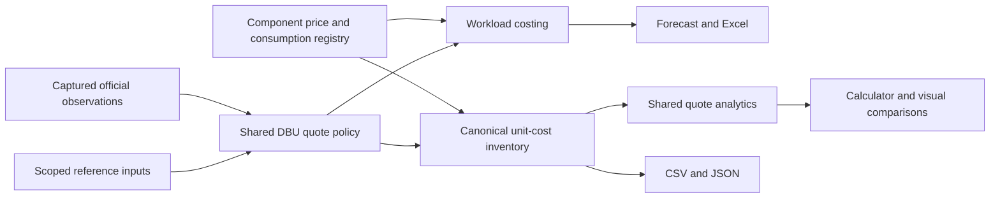

# Unit costs and source evidence

Cayfore's **Unit costs** menu explains the bundled cost of one billing or operational unit, the dimensions that change it, and the source behind it. Enter a quantity to calculate a component subtotal. Use Product map or Advanced to add a supported product to a forecast when you need schedules, growth, commitments, and other charges. This is source-cost visibility; it does not assume business value or ROI.

The inventory covers all **70 current pricing-catalog products and 8 learning-only platform concepts**. It is a curated snapshot, not a complete worldwide Databricks tariff, every current model, or an availability guarantee. Rates are USD list-price bases before contract discounts, tax, and excluded services.

## Explore the workspace

Start in **Rates & calculator**. Search or choose a product, then set its reference cloud, region, edition and component. The selected quote and billable-quantity calculator are beside the matching rows on a wide screen; on a phone, use **View selected rate** and **Back to rates**. These actions leave the forecast unchanged.

Use **More filters** for domain, pricing coverage and evidence basis. Active refinements remain counted when collapsed. **Compare regions**, **Evidence** and **Downloads** open the supporting tools without replacing your chosen placement. Calculator input and download scope survive task switches. Keyboard arrow keys move between the workspace tabs.

The same three primary workspaces—Plan, Product map and Unit costs—are visible in the header on smaller screens. The menu retains Advanced, forecast navigation and explanatory help.

## Files and commands

- [unit-costs.json.gz](../data/unit-costs.json.gz): losslessly compressed JSON inventory with component, placement, dimension, price, and provenance fields.
- [unit-costs.csv.gz](../data/unit-costs.csv.gz): the same inventory as a losslessly compressed flat CSV table for spreadsheets and joins.
- [unit-cost-evidence.json](../data/unit-cost-evidence.json): maintained source registry, source scopes, review dates, and known conflicts.
- [RESEARCH.md](RESEARCH.md): the existing calculator's detailed pricing assumptions.

```sh
# Rebuild both deterministic files from the bundled catalog.
npm run export:unit-costs

# Fail if checked-in exports no longer match their inputs.
npm run check:unit-costs

# Validate accepted official prices against retained first-party response bytes.
npm run check:sources

# Fetch the official Databricks price data for a reviewed catalog update.
npm run refresh:databricks

# Query the same inventory without opening the website. JSON is the default.
npm run cayfore -- rates --format csv --product jobs_classic --cloud azure --region eastus --tier premium --evidence official
```

Generation reads local catalog inputs; it does not fetch live prices or use a customer's account. Source review dates describe what was checked, while stored rate dates describe the underlying snapshot. Rebuilding a file does not make its rates newly verified. Cloud-price refreshes and manually researched consumption changes remain separate maintenance actions.

`export:unit-costs` writes ordinary `data/unit-costs.csv` and `data/unit-costs.json` files for local use, plus the versioned `.gz` copies. The expanded grid repeats evidence across many placement and variant combinations, so the repository stores compressed copies to keep updates small. Decompress either copy with a standard archive tool or `gzip -dk data/unit-costs.csv.gz` (use the JSON filename for JSON). The website and CLI download ordinary CSV/JSON without requiring decompression. CI expands the committed copies and compares their complete contents against the current builder.

## Source of truth and evidence levels

The shared resolver in `packages/engine/src/catalog/resolve-dbu-rate.ts` supplies the forecast, usage estimates, CLI, Excel export, and unit-cost builder. It resolves an exact Azure Retail Prices meter or a validated Databricks regional USD/DBU observation first. A documented reference base can be used only as a labeled planning fallback. Legacy secondary values and region factors remain visible where no stronger matching source exists. A known same-offering first-party conflict blocks the qualified quote rather than silently choosing a source.

`data/databricks-dbu-rates.json` contains normalized first-party prices, source locators, observations, exclusions, and quarantined issues. Its inputs are [Databricks price cards](https://www.databricks.com/en-pricing-assets/data/pricing/cards.json), [AWS calculator data](https://www.databricks.com/en-pricing-assets/data/pricing/AWS.json), and [Google Cloud calculator data](https://www.databricks.com/en-pricing-assets/data/pricing/GCP.json). Exact response bytes are retained as compressed files under `data/sources/`; SHA-256 fingerprints identify each capture. `check:sources` replays the parsers and compares the entire normalized result. This is reproducible snapshot validation, not a live-price promise.

The parsers map explicit product, cloud, edition, region, currency, and billing-unit dimensions. They exclude SAP, government offerings, incompatible units, and ambiguous values. A calculator's instance-hour example is checked against its DBU basis, and source disagreements remain reviewable. Product availability is not inferred from a price-card entry.

| UI label                    | Export value     | Meaning                                                                                                                                                         |
| --------------------------- | ---------------- | --------------------------------------------------------------------------------------------------------------------------------------------------------------- |
| Official list price         | `official`       | A first-party numeric price observation matches the row's unit and placement.                                                                                   |
| Derived from official rates | `derived`        | Published consumption rules or eligible conditions are applied; monetary quotes also require a first-party price. Azure-only rules do not verify another cloud. |
| Planning estimate           | `estimate`       | A consumption assumption, seeded infrastructure rate, regional proxy, secondary reference, or incomplete numeric provenance contributes to the result.          |
| Unresolved                  | `unresolved`     | Missing prices or conflicting sources prevent a qualified quote.                                                                                                |
| Platform context            | `not_applicable` | No standalone unit quote is asserted; connected workloads can still incur charges.                                                                              |

Every source records `authority`, `publisher`, its numeric or contextual `role`, a nullable `observedOn`, and a separate nullable `reviewedOn`. An authentic vendor page can explain a service without proving its price. A later documentation review does not refresh an older price. Unknown observation dates stay null. Catalog `verifiedOn` is retained for compatibility as a catalog metadata date; it does not verify all component prices. `reviewedOn` describes the evidence registry review.

The UI includes a source link beside the displayed price, complete source cards, evidence filters, and counts for the currently filtered rows. Browser, CLI, CSV, and JSON use the same evidence classification. Use `--evidence official` for direct first-party prices or `--evidence derived` for calculated official-rate rows.

## One quote policy, several views

`resolveDbuRate` is the single injectable USD/DBU resolution policy. It returns the rate together with its exact/reference/conflict state, source region, evidence locators, observation date, and effective date. Forecast charges, source provenance, unit-cost rows and Excel use this result rather than reimplementing precedence or regional arithmetic. A custom catalog without matching source evidence cannot inherit a vendor citation.

The lightweight `rates/components.ts` registry owns reviewed native component prices, source scope and shared consumption conversions. The forecast and unit inventory read the same Jobs Light, Clean Rooms, Data Processed, AI Parse, gateway, serving and capacity-basis definitions. Public Azure native references are priced only in their observed East US scope; other supported regions have explicit unresolved rows. Customer-supplied prices remain separate. Shared exclusions in `data/component-price-conflicts.json` withhold conflicted GTE provisioned capacity in both consumers while retaining independently priced token usage.



### Visualize a cost without mixing units

**Compare the same unit** shows regional alternatives for one exact product, component, cloud, edition, SKU, model, instance, variant, quoted quantity and dimensional basis. Prices start at zero on a shared scale. The compact view includes the lowest quotes, the highest quote and the selected region; it can expand to every comparable region. Each bar retains its evidence label and opens that region's source details. In available comparison charts, missing or conflicted amounts are excluded from the bars and counted explicitly.

**From source to unit cost** shows the source price, consumption for the quoted quantity, regional factor and component quote only when those factors reproduce the stored amount. When a complete factor breakdown is not established, the UI presents the stored quote and its limitation instead of inferring a formula. The billable-quantity calculator uses `calculateUnitCost`; invalid, inconsistent, overflowing or unresolved quotes do not produce a subtotal. Small prices retain precision.

**Evidence coverage** visualizes counts of matching rows, not a sum of spend. The shared engine computes chart scales, evidence shares and component calculations. React formats and presents those results. Charts, calculator, CLI and downloads all use the same canonical inventory. A regional price comparison does not establish service availability or an all-in workload cost.

## Read the units before calculating

Each row describes one **product, component, cloud, region, tier, and variant**. Components can include DBUs, a VM, storage, tokens, or an infrastructure assumption. Variants can include warehouse size, machine, GPU, model, input/output direction, endpoint type, or page complexity. Multiple variants are alternatives; they are not all charges to add to one workload.

`unitQuantity` states the quoted quantity, and `usdPerUnit` is normalized to one raw unit. A display quote for one million tokens can therefore coexist with a precise dollars-per-token value. Preserve precision while multiplying and round the final subtotal for display. Do not round a small token price to zero before calculating.

For example, the bundled **Azure Premium East US Jobs** rate is **$0.30/DBU**. A measured 100 DBU costs **$30 in Databricks charges**. That does not mean a cluster costs $0.30 per hour: each machine has its own DBU/hour consumption, and classic Jobs also needs the cloud VM charge. Photon changes DBU consumption; it does not change this $/DBU rate.

Another example: Azure's medium Apps consumption is 0.5 DBU/hour. At the bundled East US Interactive Serverless price of $0.95/DBU, compute is **$0.475 per app-hour**; 32 hours is **$15.20** before excluded services and discounts. The consumption rule and dollar meter have different sources. [Azure consumption rules](https://learn.microsoft.com/en-us/azure/databricks/resources/pricing), [Azure Retail Prices API](https://learn.microsoft.com/en-us/rest/api/cost-management/retail-prices/azure-retail-prices).

DBUs already imported from billing are the billed consumption after service multipliers. Applying the Data Quality, Data Classification, or Genie metering adjustment a second time overstates or understates cost. For networking charges, Databricks defines 1 GB as 2^30 bytes; do not silently join that quantity to a decimal-GB dataset. [Databricks pricing definitions](https://www.databricks.com/product/pricing).

## What a price includes

Classic clusters and SQL Classic/Pro require infrastructure in addition to Databricks DBUs. Serverless compute includes its compute infrastructure in the DBU basis; storage, networking, connected models, and other services can remain separate. SQL's bundled VM-equivalence figure is explicitly an assumption, not a published machine tariff.

A unit-cost quantity calculation is a **component subtotal**. Select the matching components and dimensions before totaling. For example, do not add every SQL warehouse size, both input token variants for different models, a whole composed agent product plus its identical child services, or both on-demand and Spot for the same VM hour. Search storage allowances and Genie eligibility can also make a flat quantity-times-price calculation incomplete.

Missing prices use JSON `null` and an empty numeric CSV cell. Missing, conflicted, excluded, or unsupported charges are not $0 services. Learning-only concepts such as Unity Catalog, Delta Lake, and Photon point to underlying billable services rather than inventing a standalone fee. A documented free component still needs its eligibility and expiry conditions.

## Evidence and coverage limits

The source registry records the role of each link: a dollar meter, a consumption conversion, a tariff, explanatory documentation, or a secondary compilation. A page explaining a product is not proof of every numeric rate on that product. Confidence belongs to the resolved **component and placement**, not merely to the product name.

- **Regional DBUs:** exact Azure meters and validated first-party Databricks regional observations take precedence. Unscoped bases and fallback regions retain reference or proxy labels. Same-key disagreements between official price cards and calculator data remain unresolved, including some Google Cloud automated-compute and serving entries. Lakehouse Real-Time regional ratios are product-specific; applying those ratios to other SKUs remains a planning assumption, even if a stored region source is named `lakehouse-rt`. [Lakehouse Real-Time Beta pricing](https://docs.databricks.com/aws/en/compute/sql-warehouse/real-time-pricing).
- **VMs and Spot:** AWS offer-file and Azure meter rates retain their own dates. GCP VM seeds and reference-region fallbacks are identified. Advisor-derived AWS Spot estimates are not live availability-zone quotes. [AWS Price List](https://docs.aws.amazon.com/awsaccountbilling/latest/aboutv2/price-changes.html), [Spot price history](https://docs.aws.amazon.com/AWSEC2/latest/UserGuide/using-spot-instances-history.html).
- **Foundation models:** the current provisioned heading is DBU/hour **per 50 model units**, with workload-dependent throughput. GTE is a source conflict: the bundled/Azure Learn value is 20, while the current Databricks page gives 100 on its quoted basis. An unqualified operational quote must remain unresolved in both the unit-cost inventory and forecast; separately priced token usage can remain in the known subtotal. Current cache, priority, batch, reservation, context, residency, and additional-model dimensions are not comprehensively modeled. [Foundation Model Serving pricing](https://www.databricks.com/product/pricing/foundation-model-serving).
- **Search storage:** the flat standard/optimized storage values and standard allowance are bundled assumptions. Azure's documented DSU rule differs from the stored flat rate. Compute-unit examples on the AI Search page do not verify every stored storage price. [AI Search pricing](https://www.databricks.com/product/pricing/ai-search).
- **Networking:** the current price page links an official tariff effective August 2024; it includes charges that Cayfore does not model. Current documents also differ on endpoint-hour billing timing. Describe omitted rates as missing calculator coverage, rather than claiming no public tariff exists. [Current networking price page](https://www.databricks.com/product/pricing/data-transfer-connectivity), [dated official tariff](https://www.databricks.com/sites/default/files/2024-08/databricks-data-transfer-pricing.pdf).
- **Photon and add-ons:** Photon factors are consumption assumptions by cloud and workload. The forecast's 10%/30% add-on scenarios are not equivalent to the Azure API's dollars-per-DBU meters. These are separately labeled planning bases, and duplicate product charges must be avoided.
- **Genie promotions:** user and service-principal rules differ. The 150 DBU user allowance, One/Agents free window through January 31, 2027, and Code metering promotion do not create one universal free or per-user price. SQL and connected services remain separate. [Genie billing and eligibility](https://docs.databricks.com/aws/en/genie/monitor-cost).

Validated first-party rates now feed the shared forecast resolver as well as the unit-cost inventory. Consumption assumptions and formulas remain separately identified. Some regional estimates change, and source conflicts can make a forecast subtotal incomplete; the interface exposes those gaps. Review an actual `system.billing.list_prices` export and your cloud bill when reconciling an invoice.

## Join and maintain the data

Use stable product/component IDs and explicit cloud, region, tier, unit, and dimension columns; labels can change. Preserve source IDs and dates in downstream tables. Do not join a source's raw `1 Hour` meter label to a VM hour without checking what that meter actually monetizes. Do not aggregate rows across variants as if they were usage records.

For customer billing, resolve prices by SKU, cloud, currency, usage unit, and the effective time interval. Keep `pricing.default`, promotional prices, and `pricing.effective_list.default` distinct; keep contract overrides separate. Free Genie usage can legitimately have no matching price-table row. [Databricks pricing system table reference](https://docs.databricks.com/aws/en/admin/system-tables/pricing).

Each Azure meter keeps its own `asOf`, meter ID, raw API unit, effective start date, and filtered lookup URL. Partial refreshes preserve older per-meter observations instead of stamping them with a new review date. A pagination limit fails rather than accepting a truncated response.

When updating the inventory, verify the source's exact offering, unit basis, region, currency, eligibility, and effective date; update the maintained input and its evidence; rebuild both exports; and run the consistency check. A newly added catalog product or dimension must appear in the inventory with either a sourced rate or an explicit unresolved reason. Price coverage is not product-availability coverage.
